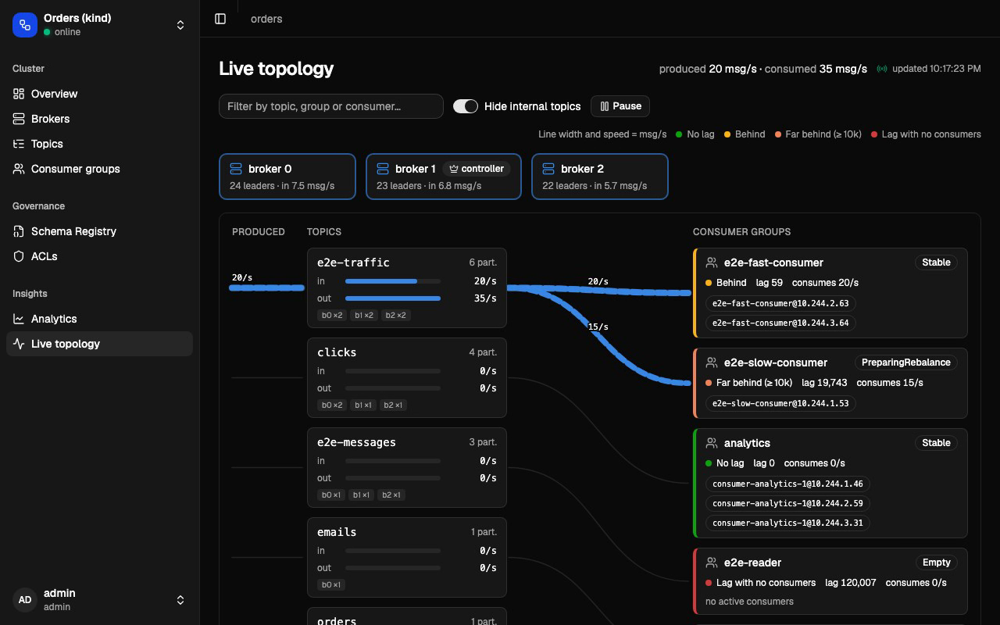
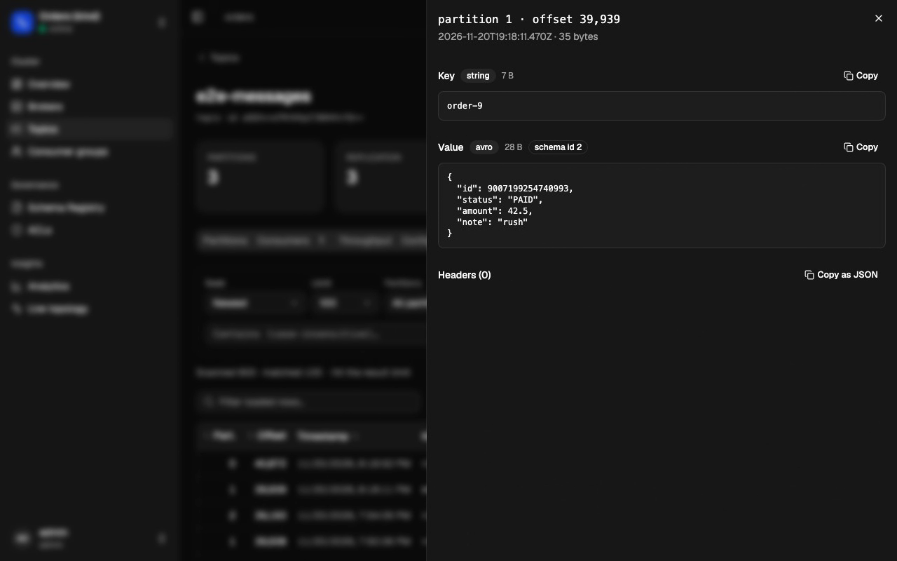
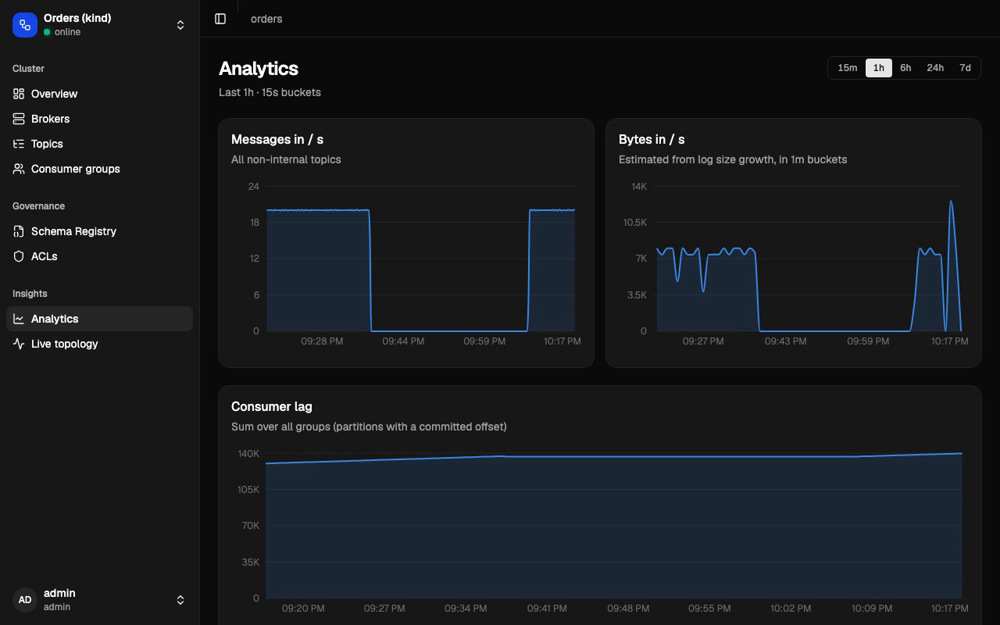

# kafka-ui

A fast, single-binary web UI for Apache Kafka. Browse topics and messages, follow consumer lag, manage ACLs and schemas, and watch messages flow from producers through topics into consumer groups, live.


kafka-ui talks to Kafka only over the Kafka protocol (Kafka 3.x+, KRaft or ZooKeeper). It does not depend on a particular distribution or operator. It is tested against Apache Kafka (via Strimzi) and Confluent images. It is a single Go binary with the web app embedded, and it needs no external database or extra services.

## Features

**Live topology.** Brokers, topics and consumer groups are laid out as a flow, and each consumer is shown as `client@host`. Line width and motion follow the message rate, lag is color-coded with labels, and consumers joining or leaving are highlighted as it happens.



**Messages.**
- Seek to newest, oldest, an offset or a timestamp, or follow new messages live.
- Search key, value and headers by substring or regex on the server, with results streamed as they are found.
- Decodes String, JSON, Base64 and Hex, plus Avro, Protobuf and JSON Schema through Schema Registry.
- Produce messages with keys, headers and schemas.



**Consumer groups.** See members and their assignments, and per-partition lag. Reset offsets to earliest, latest, an offset, a timestamp, or by ±N. A preview is required first, and only groups without active members can be reset.

**Analytics.**
- Throughput and consumer lag over time, from 15 minutes to 7 days.
- "Catch up in" estimates for each group.
- Busiest topics, partition skew across brokers.
- Hygiene checks: replication factor, `min.insync.replicas`, idle topics, empty groups.



**And the rest:**
- **Topics:** create, edit configs, add partitions, purge, delete.
- **Brokers:** overview of each broker.
- **ACLs:** list, create, delete.
- **Schema Registry:** subjects, version diff, compatibility checks, register, delete.
- **Multi-cluster** with health checks, and read-only clusters.
- **Access control:** `admin` and `viewer` roles, CSRF protection, login rate limiting, and an audit log of every change.

## Quick start

### Docker

```sh
docker build -t kafka-ui .
cp config.example.yaml config.yaml          # point `clusters` at your brokers
docker run --rm -p 8080:8080 \
  -v "$PWD/config.yaml:/etc/kafka-ui/config.yaml:ro" -v kafka-ui-data:/data \
  kafka-ui -config /etc/kafka-ui/config.yaml
```

### From source

Requires Go 1.27+ and [Bun](https://bun.sh) 1.3+.

```sh
make setup                        # Go modules and web dependencies
cp config.example.yaml config.yaml
make run                          # builds everything and starts on :8080
```

Open http://localhost:8080. The example config has two users, `admin/admin` and `viewer/viewer`. **Replace them before exposing the UI anywhere.**

## Configuration

Everything is configured in one YAML file. [`config.example.yaml`](config.example.yaml) documents every option, including SASL (PLAIN, SCRAM), TLS/mTLS, Schema Registry with basic auth, read-only clusters, data retention and sampling intervals.

```yaml
auth:
  users:
    - username: alice
      passwordHash: "$2a$10$..."   # echo -n 'secret' | kafka-ui hash-password
      role: admin                  # or viewer (read-only)
clusters:
  - id: prod
    name: Production
    bootstrap: ["broker-1:9093"]
    readOnly: true                 # every change is refused for this cluster
    sasl:
      mechanism: SCRAM-SHA-512
      username: kafka-ui
      password: ${PROD_KAFKA_PASSWORD}
    tls: { enabled: true }
    schemaRegistry:
      url: https://schema-registry:8081
```

- Secrets can be inline, `${ENV_VAR}` or `file:/path`. They never appear in logs or API responses.
- Environment overrides: `KAFKAUI_CONFIG`, `KAFKAUI_SERVER_ADDR`, `KAFKAUI_STORAGE_PATH`, `KAFKAUI_LOG_FORMAT` (`text` or `json`).
- Sessions and analytics are stored in one SQLite file (`storage.path`). The Docker image writes it to the `/data` volume. Keep that volume persistent to keep history across restarts.
- Behind HTTPS, keep `server.secureCookies` at its default (`true`).

## Kubernetes

[`deploy/k8s/kafka-ui.yaml`](deploy/k8s/kafka-ui.yaml) is a complete example: a namespace, a Secret holding the config, a PersistentVolumeClaim for the database, a Deployment and a Service.

The container runs as non-root on a read-only root filesystem. To use it:

1. Build and push the image.
2. Replace the users and clusters in the Secret, and keep passwords in a separate Secret exposed as environment variables.
3. Apply the manifest.
4. Put the Service behind your ingress with TLS.

## Development

```sh
make web-dev           # Vite dev server with hot reload on :5173 (proxies /api; set KAFKAUI_API)
make lint              # golangci-lint, Biome, TypeScript
make test              # Go unit tests (race detector) and Vitest
make test-integration  # real Kafka, an ACL-enabled Kafka and Schema Registry in Docker (testcontainers)
make coverage          # unit + integration coverage per package
make e2e               # Playwright against a running instance (KAFKAUI_E2E_URL, default http://127.0.0.1:18080)
make demo              # re-record docs/demo.gif from a running instance with traffic
```

For a full local environment, the repository includes manifests for a [kind](https://kind.sigs.k8s.io) cluster running Strimzi. Set `KIND_CLUSTER` to your cluster's name.

```sh
make kind-deploy       # build the image, load it into kind and deploy deploy/k8s/kafka-ui.yaml
make kind-forward      # http://127.0.0.1:18080
make kind-sr           # Confluent Schema Registry
make kind-secure       # a second cluster with SCRAM authentication and ACLs
make kind-traffic      # a demo producer plus a fast and a slow consumer group
```

The project layout, API conventions, design rules and contribution guidelines are described in [`SPEC.md`](SPEC.md).

## Limitations

- Producers can't be listed through the Kafka protocol. They appear as topic ingress rates.
- Broker host metrics (CPU, memory, JMX) are out of scope.
- Bytes/s is estimated from log size growth, so retention deletes can lower it.
- JSON Schema payloads are checked for valid JSON when producing, but not validated against the schema.
